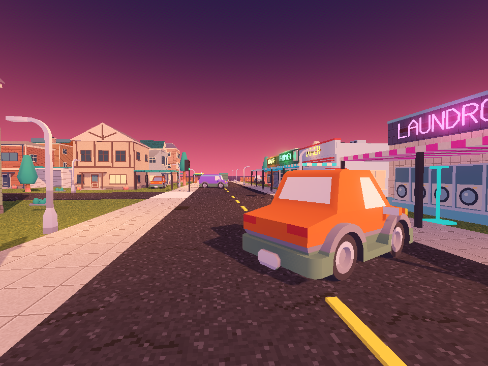
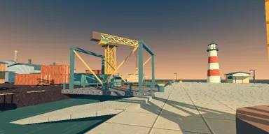
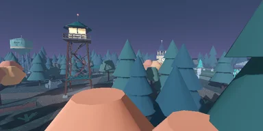

# Fallout Forecast

**A 1–4 player co-op retro FPS where a plague falls with the rain.**

Set on Halloween night, 1987, *Fallout Forecast* drops a squad of hazmat exterminators into quarantined coastal and suburban districts under an infected storm front. Survive five escalating storms, share cover before the acid eats through your suit, draft bio-mutations against each wave's forecast, gamble on crates and airdrops, and break **Cumulus**'s storm — or keep the tape rolling in Endless Mode.

Built with **Godot 4.7.2** by **Sam and Drew** for CSCI 3103.

[**Play in Browser**](https://drewdettmer.com/fallout/) · [**Download Desktop Build (Windows / Linux)**](https://github.com/kickofline/fallout-forecast/releases/tag/nightly) · [**Design Doc**](docs/design-doc.md)



---

## Features

- **The Storm Is the Enemy** — Every wave cycles through **Calm → Mutation Draft → Drizzle → Downpour (or Acid Storm) → Clearing**. As `storm_intensity` climbs, fog closes in, puddles grow, infected grow faster and deadlier, and exposed hazmat suits rapidly corrode.
- **Shelter, Puddles & Lightning** — Duck under awnings, canopies, garages, tree canopies, and thrown **Shield Domes** to stop suit drain — or refill at shared **Decon Showers**. Watch your footing: standing in a growing puddle overrides roof shelter. Lightning strikes flash the sky, trigger VHS tracking glitches, and silhouette every nearby infected through walls and fog.
- **1–4 Player Cross-Play Co-op** — Web and desktop clients connect over WebSockets (`WebSocketMultiplayerPeer`) to the same dedicated cloud server (`wss://fallout.drew.place/`), with host-authoritative combat, analytical lag compensation, contextual team pings, teammate nameplates, and player-count scaling.
- **Downed, Revive & Turned** — Hit 0 HP and teammates have 20 seconds to revive you (cut in half in rain). Miss the window and you **Turn** into an infected Drip, hunting your old squad until Clearing. Solo runs include one self-revive per wave.
- **Mutation Draft & Loadouts** — Each wave forecasts an enemy storm modifier while the squad drafts persistent **Player Bio-Mutations** (`1`/`2`/`3` or D-pad). Build a 5-slot loadout from wave-1 starter kits, mid-wave airdrops, rotating scrap vending stations, and risky **Double-or-Nothing** crates:
  - **15 Firearms** including starter Service Revolver, Pump Shotgun, Spray Rifle, Nail Driver, Hunting Rifle, Pressure Washer, Rock Salt, Battery Zapper, Flare Launcher, Harpoon, Leaf Blower, the legendary **Disruptor**, and 3 **Cursed Weapons** (*Leaky Nailgun*, *Boombox Launcher*, *Lucky Penny Revolver*).
  - **9 Throwables, Deployables & Consumables** — *Shield Dome*, *Frag Grenade*, *Umbrella Stand*, *Bleach Bomb*, *Bait Radio*, *Sandbag*, *Lightning Rod Spike*, *Med Tin*, and *Suit Patch*.
- **10 Infected Types + Miniboss & Boss** — Core hordes (**Drip**, **Gutter**, **Mister**), armored **Hailstones**, forecast specialists (**Sleet**, **Smog**, **Static**, **Thunderhead**, **Undertow**), the wave-3 named miniboss **Cloudburst**, and the wave-5 Acid Storm boss **Cumulus**.
- **31 Feats & Suit Customization** — Customize your survivor across 10 hazmat colors and 5 suit skins, with 9 looks unlocked by completing in-game feats (including 3 hidden feats).
- **1987 VHS & PS1 Presentation** — Fixed 4:3 broadcast framing, PS1-style vertex snapping, ordered dithering, VHS tracking glitches, VCR tape-loader title screen, and an original adaptive synthwave score that reacts to storm intensity, combat pressure, and boss fights.

---

## Districts

Vote on a district in the multiplayer lobby or tune directly to a channel in solo play:

| Pinecrest (`CH 01`) | Harbor Point (`CH 02`) | Maple Hollow (`CH 03`) |
| :---: | :---: | :---: |
|  |  |  |
| Main Street, neon-lit storefronts, gas canopy, cul-de-sac, and water tower. | A tidal market, Fish Exchange, walk-through Cannery, covered docks, and raised Signal Walk. | Misty pine woods and swaying maples around an old chapel, cemetery, and ranger camp. |

---

## Play or Download

### Browser
Open **[drewdettmer.com/fallout](https://drewdettmer.com/fallout/)** in a desktop browser with WebGL 2 support. Click **PLAY** to start audio, click the canvas during a run to capture the mouse, and choose **Cloud Play** to squad up with desktop or browser players on `wss://fallout.drew.place/`.

### Desktop (Windows & Linux)
Rolling builds from `master` are published automatically on [GitHub Releases (`nightly`)](https://github.com/kickofline/fallout-forecast/releases/tag/nightly):

- **Windows:** Extract `FalloutForecast-windows-x86_64.zip` and run `FalloutForecast.exe`.
- **Linux:** Extract `FalloutForecast-linux-x86_64.tar.gz` and run `./FalloutForecast.x86_64`.

> Desktop builds run the full Forward Plus renderer with the PS1 vertex-snap shader, VHS screen composite, and roof-colliding rain particles. Web builds use the Compatibility renderer tuned for browser performance and share full multiplayer compatibility with desktop builds.

---

## Controls

Full keyboard/mouse and gamepad support is built in:

| Action | Keyboard / Mouse | Gamepad |
| --- | --- | --- |
| Move | `W` `A` `S` `D` / Arrow Keys | Left Stick |
| Look | Mouse | Right Stick |
| Fire / Melee (Turned) | `LMB` | `RT` |
| Aim Down Sights | `RMB` (hold) | `LT` (hold) |
| Jump | `Space` | `A` / Cross |
| Sprint | `Shift` | `L3` |
| Crouch | `Ctrl` / `C` | `B` / Circle |
| Reload | `R` | `X` / Square |
| Switch Slots (1–5) | `1`–`5` / Mouse Wheel | `LB` / `RB` |
| Interact / Pick Up / Revive / Decon | `E` | `Y` / Triangle |
| Drop Selected Item | `G` | `R3` |
| Toggle Tarp | `T` | D-pad Up |
| Ping / Hold for Ping Wheel | `Z` / Middle Mouse | D-pad Down |
| Ready Up (skip Calm / Clearing) | `H` | `Select` / Back |
| Draft Starter Kit / Mutation Card | `1` / `2` / `3` | D-pad |
| Pause | `Esc` | `Start` / Menu |
| Toggle Fullscreen | `F11` | — |

---

## Running from Source

### Requirements
- **Godot 4.7.2** (Forward Plus, Jolt Physics) — [official releases](https://github.com/godotengine/godot-builds/releases/tag/4.7.2-stable)
- *(Optional)* Python 3 for regenerating synthesized audio in [`tools/audio/`](tools/audio/)

### Run the Game
```sh
# First time (or after adding new assets / class_name scripts)
godot --headless --path . --import

# Launch the game (entry scene: res://ui/title.tscn)
godot --path .
```

### Run a Local Dedicated Server
Multiplayer uses a dedicated headless WebSocket server (peer 1, no local player):

```sh
godot --headless --path . --audio-driver Dummy -- --server --port=7777
```

Then in the game, open **Settings → Server (WSS)**, point it to `ws://127.0.0.1:7777/`, and select **Cloud Play**.

For Docker deployment, Web exports, and telemetry details, see:
- [`server/README.md`](server/README.md) — Dedicated server flags, Docker image, and reverse-proxy setup
- [`web/README.md`](web/README.md) — Web export instructions and Nginx container
- [`server/telemetry/README.md`](server/telemetry/README.md) — Opt-out anonymous performance & run telemetry (`Settings → Send Telemetry`)

### Debug Keys *(debug builds only)*
| Key | Effect |
| --- | --- |
| `F1` | Advance to next storm phase |
| `F2` | Jump to Wave 5 (Acid Storm / Cumulus) |
| `F3` / `F4` / `F5` | Spawn a Drip / Gutter / Mister |
| `F6` | Trigger a lightning strike |
| `F8` | Toggle Retro / VHS shader pass |
| `F9` | Toggle debug HUD text |
| `F10` | Open the Developer Menu |

---

## Project Structure

```text
fallout-forecast/
├── game/          # Autoloads: Net, GameManager, Sound, Settings, RNG, Feats, LagComp, Telemetry
├── player/        # First-person controller, hazmat model, cosmetics, revive spots
├── weapons/       # 15 firearms, cursed weapons, throwables/deployables, projectiles, loot catalog
├── enemies/       # Infected AI, wave director, specialists, Cloudburst miniboss, Cumulus boss
├── weather/       # WeatherManager state machine, rain/fog FX, lightning silhouettes, puddles
├── levels/        # Pinecrest, Harbor Point, and Maple Hollow scenes
├── crates/        # Supply stations, airdrops, mystery & Double-or-Nothing crates
├── props/         # Procedural buildings, neon lettering, decon showers, shelters, trees, batching
├── retro/         # PS1 vertex-snap shader, VHS screen composite, web material folding
├── ui/            # VCR title screen, lobby, HUD, compass, ping wheel, mutation draft, feats, results
├── server/        # Headless server Dockerfile, compose, healthcheck, and telemetry collector
├── web/           # Custom 4:3 VHS web shell, Dockerfile, and Nginx config
├── tools/         # Procedural audio generators, level builders, playtest & telemetry scripts
├── docs/          # Game design document snapshot
└── assets/        # Remapped Kenney CC0 models, 64x64 pixel textures, fonts, audio, UI icons
```

---

## Credits & Licenses

- **Game Design, Code, Levels, Shaders & Synthesized Audio:** Sam and Drew (CSCI 3103)
- **3D Kits & Base SFX:** [Kenney](https://kenney.nl/assets) (CC0 1.0) — City Kit Suburban & Commercial, Car Kit, Graveyard Kit, Roads, Characters, and Blaster Kit, color-remapped to the 1987 palette
- **Fonts:** [VT323](assets/fonts/VT323-OFL.txt) and [Barlow Condensed](assets/fonts/OFL.txt) (SIL Open Font License)
- **Original Audio & Synthesis Credits:** See [`assets/audio/CREDITS.md`](assets/audio/CREDITS.md)
